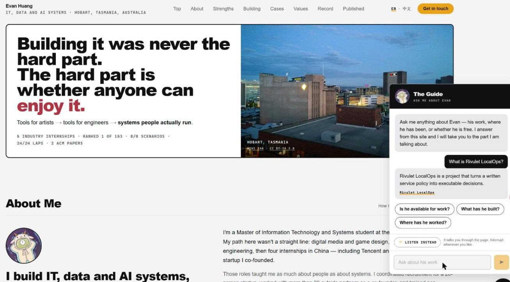
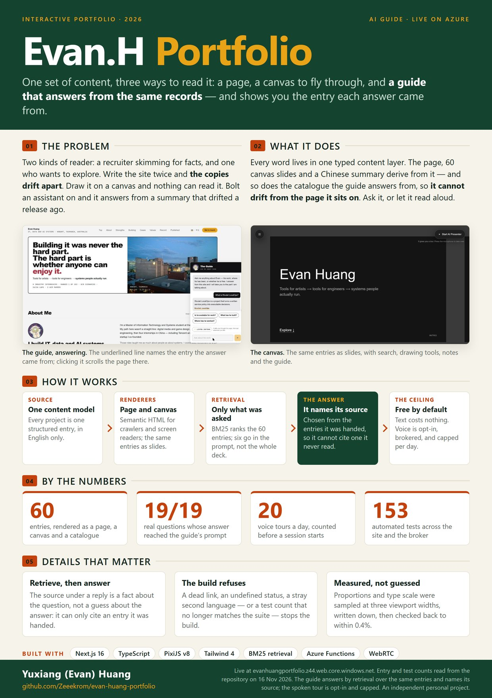

# Evan.H Portfolio

**English** · [简体中文](README.zh-CN.md)


A portfolio has two readers: someone skimming for facts, and someone who wants to look around. Writing the site twice is how the two copies start disagreeing, so this one is written once. Every word lives in a typed content layer, and the page, a 60-slide WebGL deck, the menu, the search index, the sitemap and a Chinese summary are all derived from it.

It also has a guide you can ask. The guide answers **only** from a catalogue generated out of the same records that render the page, so it cannot drift from what the visitor is looking at — and it retrieves before it answers, so the source line under a reply names a slide the model was actually given rather than one inferred from what it said. It moves the page to whatever it is talking about. You can read it or, if you would rather, listen to it.

This is a personal site, not a product. It holds Evan's own material: no third-party personal data, no client work, and nothing that needs an account to see.

The development repository is private. This one is the published mirror — the same application source, documents and content, synced on release.

<table>
<tr>
<td><a href="media/guide.jpg"></a></td>
<td><a href="media/poster.jpg"></a></td>
</tr>
<tr>
<td align="center">The guide, answering</td>
<td align="center"><a href="media/poster.jpg">Poster</a></td>
</tr>
</table>

**[Open the site](https://evanh.dev/)** — the page, and the guide in the corner.

**[The canvas deck](https://evanh.dev/explore/)** — the same sixty entries as a WebGL map to pan and zoom, with a voice guide that drives the camera while it talks.

**[中文摘要](https://evanh.dev/zh/)** — one page in Chinese: who he is, what he is looking for, what he built, how to write. The site is otherwise English only.

The screenshot above is one question answered on the live site. The underlined line beneath the answer is the slide it came from; clicking it scrolls the page there and marks the section. That line is the point of the whole guide — an answer you can check beats an answer you have to believe, which is the argument the rest of the site makes too.

## Contents

- [At a glance](#at-a-glance)
- [The problem](#the-problem)
- [Who it is for](#who-it-is-for)
- [One question, start to finish](#one-question-start-to-finish)
- [What works today](#what-works-today)
- [The guide, and what it is allowed to do](#the-guide-and-what-it-is-allowed-to-do)
- [Design principles](#design-principles)
- [How it was built](#how-it-was-built)
- [Problems that became rules](#problems-that-became-rules)
- [Technology stack](#technology-stack)
- [Verification evidence](#verification-evidence)
- [What is not finished](#what-is-not-finished)
- [What the project showed](#what-the-project-showed)
- [Running it](#running-it)
- [Editing the content](#editing-the-content)
- [Documentation](#documentation)
- [Copyright and terms](#copyright-and-terms)

## At a glance

| | |
| --- | --- |
| What it is | A personal portfolio written once and rendered three ways — a page, a 60-slide WebGL deck and a Chinese summary — with a guide that answers from the same records and moves the page to what it is describing |
| Who it is for | Recruiters and hiring managers who want facts quickly; engineers who want to see how it is put together; visitors who read Chinese; and anyone using a screen reader, a crawler or a browser with JavaScript switched off |
| The problem | Two kinds of reader, one set of facts. Write the site twice and the copies drift; draw it on a canvas and nothing can read it; bolt a chatbot on and it answers about a version of the site that no longer exists |
| AI | A text guide on GLM-4.7-Flash, which is free, so asking costs nothing. BM25 retrieval over the sixty slides picks the handful a question is about, and only those go in the prompt — 2,698 characters of persona plus what was retrieved, against 27,526 for the whole deck. An opt-in voice tour runs on OpenAI Realtime over WebRTC, capped at 20 sessions a day, counted server-side before a session is minted |
| Stack | Next.js 16 static export, TypeScript, Tailwind CSS 4, PixiJS v8, Azure Storage and Azure Functions, GitHub Actions |
| Evidence | 104 unit tests for the site and 47 for the broker; a content model that fails the build rather than the page; retrieval checked against 19 real questions; layout measured to within 0.4% of the reference it was built from |
| Data | Evan's own material only. No third-party personal data, no client work, no account needed to see any of it |
| Status | Live. A personal site that is maintained, not a product and not for reuse |

## The problem

A portfolio is read in two incompatible ways. A recruiter has thirty seconds and wants facts: what was built, what changed, is he available. Someone else — another engineer, usually — wants to wander around and see how it works. Serve the first and the site is a résumé in HTML. Serve the second and the facts are buried in an experience.

Writing it twice solves it for a week. Then one copy gets a new project and the other does not, and the visitor is the one who finds out.

Three things tend to go wrong after that, and this site is mostly an answer to them:

- **Text drawn into a canvas is pixels.** A crawler cannot read it, a screen reader cannot speak it, Ctrl+F cannot find it.
- **A number written in prose goes stale.** "81 tests" was true once. It is a claim, and a claim nobody checks is decoration.
- **An assistant bolted to a portfolio answers about a profile, not a page.** The usual shape is a hand-written summary in a system prompt. It is a second copy of the content, it drifts from the first within a release or two, and the visitor is the one who discovers that the bot cannot answer a question whose answer is on the screen behind it.

## Who it is for

| Reader | What they need | What the site does |
|---|---|---|
| Recruiter or hiring manager | Is he available, and what has he actually done? | Availability is quoted from the content record, by the page and by the guide, which is forbidden from reasoning its way to a different answer. Every project says what changed, not what was used |
| Engineer reading the code | How is this put together, and what went wrong on the way? | `docs/`, and [Problems that became rules](#problems-that-became-rules) below — the failures are on the record, including the ones found by testing the live system rather than the local one |
| Someone who does not read English | Who is this, and how do I reach him? | A Chinese summary page at `/zh`, which states no fact of its own: every project line is keyed to a slug, every paper to a DOI, and the build fails if a project is added in English without one |
| A screen reader, a crawler, or a browser with JavaScript off | The content, not a loading screen | The semantic DOM is not a fallback — it is the exported HTML, complete. The canvas hides it visually once it starts and leaves it in the accessibility tree |
| Someone who would rather listen | To be talked through it | An opt-in voice tour, seven stops, interruptible at any point |

## One question, start to finish

A visitor opens the panel in the corner and asks *what is Rivulet LocalOps?*

1. **The panel wakes the broker.** Opening the panel sends a preflight — no model call, no cost — so the Azure Function is warm by the time the visitor has finished typing. A cold start measured 14.1 seconds against 2.6 warm.
2. **Retrieval picks the slides.** BM25 over the deck, built at load, ranks the sixty slides against the question and takes the top six. If nothing clears the floor — "hello", "who is he" — it falls back to a spine of seven slides that answer *who is this* and *how do I reach him*, rather than the top six of a meaningless ranking.
3. **Only those slides go in the prompt.** The persona plus what was retrieved, not the whole deck. The model is told to answer from them and nothing else.
4. **The answer comes back with its source.** Navigation is chosen from the slides the model was shown, so the source line cannot name something it never read.
5. **The page moves.** A slide is a section here and a camera position on the canvas, so the page scrolls to that section and marks it for a moment. When the answer comes from one of the fourteen slides the deck carries and the page does not — the volunteering, education — the source links to the canvas instead.

Measured on the live site: 4.4 to 5.3 seconds, consistently.

## What works today

| Capability | Implemented evidence |
|---|---|
| One content source | `content/*.json` behind a typed loader; the page, 60 slides, the menu, the search index, the sitemap, the Chinese page and the guide's catalogue are all derived from it |
| Two renderers | Semantic DOM in the exported HTML, and a PixiJS v8 canvas over the top; the DOM stays in the accessibility tree |
| Content checked like code | A link that resolves to nothing, a status nobody defined or a stray second language fails `npm run build`, not the page. `npm run content` adds referential integrity, per-field length budgets against what the guide can read, and a check that the test count claimed on the site matches the suite |
| Text guide | Retrieval-backed, answers only from the catalogue, names its source, scrolls the page to it or links to the canvas |
| Voice guide | Opt-in; seven stops on a route of its own, because two of the canvas tour's stops have no section on this page; interruptible; the client never holds a credential |
| Cost control | Text runs on a free model. Voice is capped at 20 sessions a day, claimed server-side with an ETag before a session is minted, failing closed, and released when the session was never minted |
| Chinese summary | `/zh`, paired to the English records by slug and DOI, with hreflang both ways and its own sitemap entry |
| Measured layout | Computed styles sampled at 1600, 1280 and 900px, written down, checked back against the rebuild to within 0.4% |
| Deep links | `/explore/#<slide-id>` lands on that slide, including the 26 such URLs in the sitemap |

## The guide, and what it is allowed to do

The interesting part of an assistant on a personal site is not that it talks. It is what it is allowed to say, and whether you can check it.

- **It answers from the site, or not at all.** Its whole knowledge is a catalogue generated from the records that render the page. It is told not to explain what a company or a technology is — the visitor asked what Evan did there — and not to write "likely" or "probably" about him.
- **One answer is quoted rather than reasoned about.** Availability. It is the first question a recruiter asks, and a model that reasons from *he is studying and interning* arrives at *he is not available*, which is false.
- **The source is a fact about the request.** Retrieval happens before the answer, so the slide named underneath is one the model was given. Deriving it from the reply afterwards — which is what this did first — can name a slide it never read.
- **It has no tool here.** The navigation tool belongs to the voice session; the text endpoint does not offer it, and the model is told so, because a model asked to call something it was never given performs the call in prose.
- **Voice costs money, so it has a ceiling.** Twenty sessions a day, counted before anything is minted. The per-call length cap runs in the browser and a determined visitor could defeat it — that is stated in the code rather than glossed, because the difference between the two is the difference between a control and a courtesy.
- **Nothing it says reaches the content.** The guide is read-only. Content changes go through the content layer and CI like any other change.

## Design principles

- **Write it once.** Every surface is derived. Adding a project is one entry; nothing else is touched.
- **The DOM is the artifact, not the fallback.** The canvas is the thing over the top.
- **The build refuses, not the page.** A broken reference is a failed build, not a visitor's problem.
- **Facts carry their source.** Every answer names where it came from; every figure on the site is from the content records.
- **A number in prose is a claim.** If it is worth writing, it is worth a check that fails when it goes stale.
- **Measure rather than impress.** Proportions and type scale came from computed styles across three viewports, written down, then checked back.
- **The free path is the default path.** Text answers cost nothing, so the button can sit on the landing page. Voice is opt-in and capped.
- **Say which controls are real.** The daily ceiling is enforced; the per-call cap is a courtesy. Both are documented as what they are.

## How it was built

| Stage | What it added |
|---|---|
| Content layer | `content/*.json` with a typed loader; everything derived from it; the build fails on a broken link, an invented status or a second language |
| The canvas | 60 slides over one `Slide[]`, with search, drawing tools, sticky notes and deep links |
| Voice on the canvas | WebRTC through an Azure Function broker that mints a short-lived secret and exchanges the SDP, so the browser never holds a credential |
| Rebuilt page | Layout measured from a reference site at three viewports and rebuilt to within 0.4%; the canvas demoted to a link in the footer |
| Chinese summary | `/zh`, keyed to the English records, with a guard that fails the build when the two fall out of step |
| Guide, phase 1 | The corner panel wired to the broker, with the source line and the slide-to-section mapping — after fixing three defects found by testing the live system |
| Guide, phase 2 | BM25 retrieval, so the prompt is the persona plus what the question is about, and the source is what the model was given |
| Guide, phase 3 | Opt-in voice on the page, its own route, and a server-side daily budget |

The order mattered: the content layer came before the surfaces, and correctness came before reach — the panel was not advertised until it stopped answering the availability question backwards.

## Problems that became rules

| What went wrong | What changed |
|---|---|
| The model printed `navigate_to_slide` as prose instead of calling it, in five different shapes over five questions. Every live answer opened with a line of machinery, and one answer was nothing but the stage direction | The destination is recovered from any shape and the call's own sentence is cut — by sentence, not by line, because the fourth shape put the answer on the same line. And the endpoint stopped asking for a tool it does not offer |
| Asked whether Evan was free for work, the live guide answered that he was not — the opposite of true, to the first question a recruiter asks | `hero.available` had never reached the catalogue, and the persona listed availability among the things the guide does not have. It is read from the content record now and quoted rather than reasoned about |
| The canvas wrote `#<slide-id>` as the camera settled and never read one back, so every deep link — including the 26 in our own sitemap — landed on the title card | The hash is honoured on load, and a deep link lands on its slide instead of playing the opening at someone who asked for an address |
| The first retrieval scored 7 of 16. IDF rates a word by how rare it is in the answers, and "tell" appears on exactly one slide, whose body opens "Tell me what keeps breaking" — so "tell me about his volunteering" returned the contact card | Question words are dropped. That is a query-side list, which is a different thing from the corpus-side one IDF exists to avoid |
| Length normalisation at the usual 0.75 let two-line cover cards beat two-thousand-character bodies | B is 0.3 |
| The subject's own name is on every slide of his own portfolio, and the title weight made it the strongest term in "What did Evan do at Tencent?" | The name is dropped from the index, and slide ids are indexed instead — the contact card never says "contact", but its id does |
| Stripping "es" turned "values" into "valu" and matched nothing | The English plural rule: "es" only goes after a sibilant |
| The test count is claimed in seven places and went stale twice in one day | `npm run content` counts the suite and fails the build when a claim disagrees. It is anchored to this site's own phrasing, because another project's bullet says "77 automated tests", which is true and is not this number |
| A reveal animation added a class to a React-managed `className` and was wiped on the next render, hiding whole sections | The observer sets a data attribute instead |
| `Compress-Archive` on Windows wrote entry names with backslashes; the Linux Functions host read them as filenames, so `node_modules` never resolved and not one function registered — the whole app answered 404, including the endpoints that had been working | The deploy packs with `zipfile`, which always writes forward slashes, and asserts it |
| A 204 preflight had its response headers dropped by the runtime, so the browser refused the real request with a bare "Failed to fetch" and nothing in the logs, because it never sent it | The preflight answers 200 with an empty body |
| The deploy script's own guard crashed with a `UnicodeEncodeError` instead of printing why it had stopped, because a Windows console is cp1252 and the message starts with a warning sign | It sets its output encoding |

## Technology stack

| | |
|---|---|
| Framework | Next.js 16, App Router, `output: "export"` |
| Canvas | PixiJS v8 (WebGL2) |
| Styling | Tailwind CSS 4 |
| Hosting | Azure Storage static website |
| Broker | Azure Functions, Consumption, Node 24 |
| Storage | Azure Table Storage — sticky notes, and the voice budget |
| Text model | GLM-4.7-Flash, with a second free model as fallback |
| Voice | OpenAI Realtime over WebRTC, brokered |
| Retrieval | BM25 over the slide catalogue, in-process, no index to build |
| CI/CD | GitHub Actions |

## Verification evidence

| What | How it is checked |
|---|---|
| Content model | `npm run content` — referential integrity, controlled vocabularies, English-only outside `content/zh.json`, per-field length budgets against what the guide can read, and the test-count claim |
| Site behaviour | 104 unit tests: slide generation, the grid, tour sequencing, turn tracking, the Chinese pairing, the slide-to-section mapping and the voice tour's route |
| Broker | 47 tests: the printed-call shapes measured live, retrieval against real questions, and the voice budget including contention, failing closed and releasing a claim. 19 of them need a local Azurite |
| Retrieval quality | The right slide reaches the prompt for 19 of 19 real questions; subject-less questions fall back to the spine |
| Layout | Computed styles at three viewports against the written measurements, within 0.4% |
| Live behaviour | Answers, latency and source lines checked against the deployed broker after each release, not only locally — which is where three of the defects above were found |

## What is not finished

**A recommendations section.** The structural gap on the page. It needs real quotes from people Evan has worked with, and placeholder testimonials would be worse than the gap.

**Two documents are still in Chinese.** `docs/ARCHITECTURE.md` and `docs/CONTENT.md` reach this mirror in Chinese while the rest of it is English.

**The per-call voice cap is browser-side only.** Once the SDP is exchanged, audio runs between the browser and the provider with the broker out of the path, so nothing on the server can end a call already running. The daily ceiling is the control; this one is a courtesy.

**The Chinese page's share card is in English.** `next/og` needs an embedded CJK font to draw Chinese, which has not been done.

**There is no authentication anywhere.** `/admin` is a static page holding no secret; the key is typed once and kept in that browser. Everything else is public by design.

## What the project showed

- An answer is only as checkable as the record of what it was given. Deriving the source from the reply afterwards names a slide the model may never have read.
- A model told to call a tool it was not given will perform the call in prose, confidently, in whatever shape it likes.
- IDF is a statistic about a corpus and gets questions backwards: a word can be rare in the answers and meaningless in the question.
- A number written in prose goes stale; a number the build checks does not. This one went stale twice in a day before it was checked.
- The ceiling you can enforce is worth more than the one you would like to have — and saying which is which is part of the design, not a footnote.
- Testing the deployed system finds things testing the local one cannot. Every defect in the table above that mattered to a visitor was found that way.

## Running it

```bash
npm install
npm run dev          # http://localhost:3000
```

```bash
npm run build        # static export to out/
npm test             # 104 unit tests
npm run content      # content model checks
npm run content:map  # regenerate the content slot inventory
```

The guide and the sticky notes call a deployed Azure Function, which answers only origins on its allowlist — so on `localhost` they report that they cannot reach it, which is the guard working. Everything else runs locally.

## Editing the content

Content is edited through a form at [Pages CMS](https://pagescms.org): it reads `.pages.yml`, writes to `content/*.json`, and commits like any other change, so CI validates and deploys it. Editing the JSON directly works just as well.

New material arrives through a separate inbox and `npm run intake`, which reports what is new and what is already on the site. It never writes to `content/` — proposals are made, checked by the content model, and committed by hand.

## Documentation

| | |
|---|---|
| [docs/GUIDE.md](docs/GUIDE.md) | The guide: what it is allowed to do, how retrieval was built and measured, and what each phase actually cost |
| [docs/ARCHITECTURE.md](docs/ARCHITECTURE.md) | How the system works: grid and camera parameters, routing, theming, the tools, the notes backend, the voice guide, deployment — and the traps hit along the way |
| [docs/CONTENT.md](docs/CONTENT.md) | The content layer: what one entry turns into, and what updates on its own |
| [docs/CONTENT-SLOTS.md](docs/CONTENT-SLOTS.md) | Every writable field, its format and where it appears (generated) |
| [DEPLOYMENT.md](DEPLOYMENT.md) | Hosting choices and the deploy pipeline |
| [content/README.md](content/README.md) | For whoever edits the words rather than the code |

## Copyright and terms

© 2026 Evan Huang. All rights reserved; see [LICENSE](LICENSE).

This repository is public to be read. The architecture, the content model and the notes in `docs/` are meant to be useful to anyone looking at how it is put together, and sharing links is welcome. It is not licensed for reuse: the code, design, written content, images and CV may not be republished, copied or adapted without written permission. The borrowed photograph on the opening plate keeps its own licence and carries its credit on the page.

If something here would help you, get in touch.
