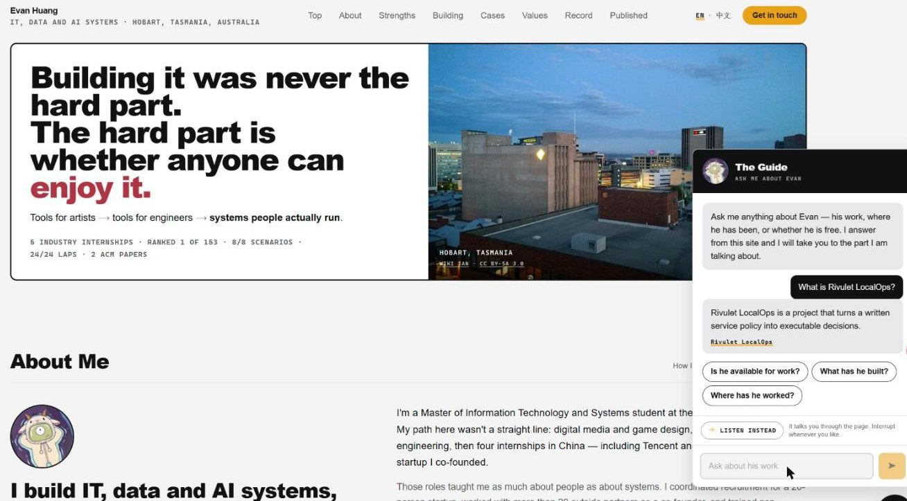
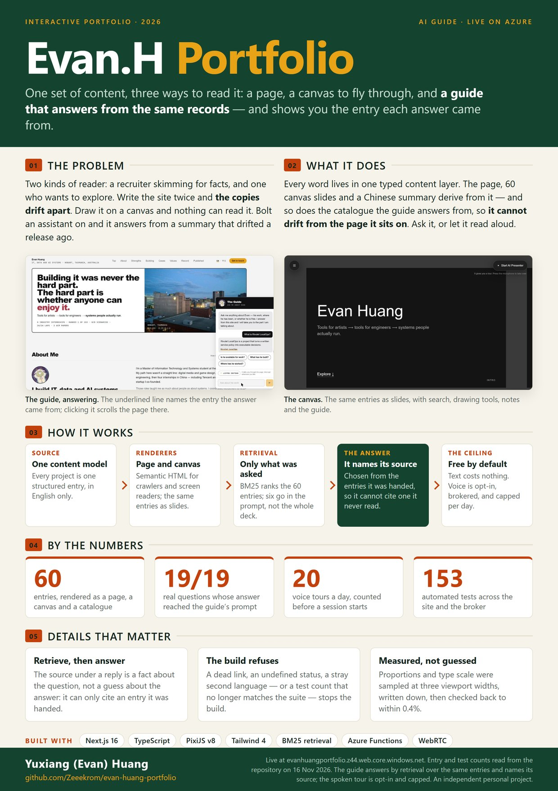

# Evan.H Portfolio

<p align="right"><a href="README.md">English</a> · <strong>简体中文</strong></p>


作品集有两种读者：一种在快速找事实，另一种想四处看看。把站写两遍，两份文案迟早开始互相矛盾，所以这个站只写一遍。每个字都放在一层带类型的内容层里，页面、60 张幻灯的 WebGL 画布、菜单、搜索索引、站点地图和中文摘要，全部从它派生。

它还有一个可以问的向导。向导**只**从一份目录回答，而这份目录由渲染页面的同一批记录生成——所以它不可能和访客正在看的东西脱节。而且它**先检索再回答**，因此答案下面那行出处指的是模型实际拿到过的幻灯，不是从它说过的话里反推出来的。它还会把页面移到自己正在讲的地方。你可以读，也可以让它念给你听。

这是个人网站，不是产品。里面只有 Evan 自己的材料：没有第三方个人信息，没有客户项目，也没有任何需要登录才能看的东西。

开发仓库是私有的。这个是发布镜像——同一份应用源码、文档和内容，随发布同步。

<table>
<tr>
<td><a href="media/guide.jpg"></a></td>
<td><a href="media/poster.jpg"></a></td>
</tr>
<tr>
<td align="center">向导正在作答</td>
<td align="center"><a href="media/poster.jpg">海报</a></td>
</tr>
</table>

**[打开网站](https://evanh.dev/)** —— 页面，以及角落里的向导。

**[画布版](https://evanh.dev/explore/)** —— 同样这六十条内容做成可缩放漫游的 WebGL 地图，配一个边讲边开镜头的语音向导。

**[中文摘要](https://evanh.dev/zh/)** —— 一页中文：我是谁、在找什么、做过什么、怎么联系。站的其余部分是纯英文。

上面那张图是线上真实回答的一个问题。答案下面那行带下划线的字是它的出处，点一下页面会滚过去并把那一段标出来。**那一行就是整个向导的意义**——能核对的答案胜过只能相信的答案，这也是这个站在别处一直在讲的事。

## 目录

- [一眼看懂](#一眼看懂)
- [问题](#问题)
- [写给谁看](#写给谁看)
- [一个问题，从头到尾](#一个问题从头到尾)
- [现在能做到什么](#现在能做到什么)
- [向导，以及它被允许做什么](#向导以及它被允许做什么)
- [设计原则](#设计原则)
- [怎么一步步建起来的](#怎么一步步建起来的)
- [踩过的坑，变成了规则](#踩过的坑变成了规则)
- [技术栈](#技术栈)
- [验证证据](#验证证据)
- [还没做完的](#还没做完的)
- [这个项目说明了什么](#这个项目说明了什么)
- [本地运行](#本地运行)
- [怎么改内容](#怎么改内容)
- [文档](#文档)
- [版权与条款](#版权与条款)

## 一眼看懂

| | |
| --- | --- |
| 这是什么 | 一个只写一遍、渲染成三种形态的个人作品集——页面、60 张幻灯的 WebGL 画布、中文摘要——外加一个从同一批记录回答、并会把页面移到它正在描述之处的向导 |
| 写给谁 | 想快速拿到事实的招聘方；想看它怎么搭起来的工程师；读中文的访客；以及用读屏软件、爬虫或者关掉 JavaScript 的浏览器的人 |
| 要解决的问题 | 两种读者，一套事实。写两遍会漂移；画在画布上什么都读不到；外挂一个聊天机器人，它回答的是一个已经不存在的版本 |
| AI | 文字向导跑在免费的 GLM-4.7-Flash 上，所以提问不花钱。BM25 在六十张幻灯上检索出问题真正涉及的那几张，只有它们进 prompt——2,698 字符的人格加上检索结果，而整副牌是 27,526 字符。语音导览走 OpenAI Realtime + WebRTC，**要点才开**，每天 20 次封顶，在铸会话之前由服务端计数 |
| 技术栈 | Next.js 16 静态导出、TypeScript、Tailwind CSS 4、PixiJS v8、Azure Storage 与 Azure Functions、GitHub Actions |
| 证据 | 站上 104 个单元测试，broker 47 个；内容模型让**构建**失败而不是让页面出错；检索在 19 个真实问题上验证；版式与参考站的测量值偏差在 0.4% 以内 |
| 数据 | 只有 Evan 自己的材料。没有第三方个人信息，没有客户项目，没有任何需要账号才能看的东西 |
| 状态 | 已上线。一个在维护的个人网站，不是产品，也不授权复用 |

## 问题

作品集会被两种互不兼容的方式读。招聘方只有三十秒，要的是事实：做了什么、因此改变了什么、现在有没有空。另一种人——通常是另一个工程师——想到处逛逛，看它怎么工作。只服务前者，这个站就是一份 HTML 简历；只服务后者，事实就埋在体验里。

写两遍能解决一个星期。然后其中一份加了新项目、另一份没加，最后发现的是访客。

接下来通常还会坏三件事，这个站基本上就是对它们的回答：

- **画进画布的文字就是像素。** 爬虫读不到、读屏软件念不出、Ctrl+F 搜不着。
- **写在文案里的数字会过期。**「81 个测试」曾经是真的。它是一句主张，而没人核对的主张只是装饰。
- **外挂在作品集上的助手回答的是一份简介，不是这个页面。** 常见做法是把一段手写的简介塞进 system prompt。那是内容的第二份副本，一两个版本之内就会和第一份漂移，最后发现的是访客——他会看到机器人答不出一个答案就写在它背后屏幕上的问题。

## 写给谁看

| 读者 | 他要什么 | 这个站怎么给 |
|---|---|---|
| 招聘方 / 用人经理 | 他现在有空吗，到底做过什么？ | 可用性由内容记录逐字引用，页面和向导都是，而向导被明令禁止自己推理出另一个答案。每个项目讲的是「因此改变了什么」，不是「用了什么」 |
| 读代码的工程师 | 这东西怎么搭的，过程中坏过什么？ | `docs/`，以及下面的[踩过的坑](#踩过的坑变成了规则)——失败都留在记录里，包括那些只有测线上系统才会暴露的 |
| 不读英文的人 | 这人是谁，怎么联系？ | `/zh` 中文摘要页。它自己不存任何事实：每条项目按 slug、每篇论文按 DOI 指回英文记录，英文加一个项目而中文没跟上，构建直接失败 |
| 读屏软件、爬虫、关掉 JS 的浏览器 | 要内容，不要加载动画 | 语义化 DOM 不是降级方案——它就是导出的 HTML，完整的。画布启动后只在视觉上把它藏起来，仍留在无障碍树里 |
| 更想用听的人 | 有人讲给他听 | 要点才开的语音导览，七站，随时可打断 |

## 一个问题，从头到尾

访客打开角落的面板，问 *what is Rivulet LocalOps?*

1. **面板先把 broker 叫醒。** 打开面板就发一个 preflight——不调模型、不花钱——等访客打完字，Azure Function 已经热了。实测冷启动 14.1 秒，热的时候 2.6 秒。
2. **检索挑出幻灯。** BM25 在加载时建索引，把六十张幻灯按问题排序，取前六。如果没有一张过得了阈值——「hello」「who is he」——就退回一组七张的 spine，回答「这人是谁」和「怎么找他」，而不是把一个无意义排序的前六塞过去。
3. **只有那几张进 prompt。** 人格加检索结果，不是整副牌。并且明确告诉模型：只许从这些里回答。
4. **答案带着出处回来。** 导航只能在模型看过的幻灯里选，所以出处那行不可能指向它没读过的东西。
5. **页面跟着动。** 一张幻灯在这一页上是一个区块、在画布上是一个机位，于是页面滚到那个区块并短暂高亮。如果答案来自那十四张「画布有、页面没有」的幻灯（志愿、教育），出处就改成链去画布。

线上实测：4.4 到 5.3 秒，很稳。

## 现在能做到什么

| 能力 | 实现与证据 |
|---|---|
| 单一内容源 | `content/*.json` + 一层带类型的加载器；页面、60 张幻灯、菜单、搜索索引、站点地图、中文页和向导的目录全部由它派生 |
| 两个渲染器 | 语义化 DOM 在导出的 HTML 里，PixiJS v8 画布盖在上面；DOM 始终留在无障碍树中 |
| 内容像代码一样被检查 | 链接指向不存在的东西、状态不在词表里、混进第二种语言，都会让 `npm run build` 失败，而不是让页面出错。`npm run content` 另加引用完整性、按向导实际能读的长度做的字段预算，以及「站上写的测试数是否等于真实测试数」 |
| 文字向导 | 带检索、只从目录回答、标出出处、把页面滚过去或链去画布 |
| 语音向导 | 要点才开；七站，走首页自己的路线（画布那条路线有两站在首页没有区块）；可打断；浏览器从不持有任何凭据 |
| 成本控制 | 文字跑在免费模型上。语音每天 20 次封顶，在铸会话之前由服务端带 ETag 扣减，**失败时关闭**，会话没铸成功会退回 |
| 中文摘要 | `/zh`，按 slug 和 DOI 与英文记录配对，两边 hreflang 互指，站点地图有自己的条目 |
| 量出来的版式 | 在 1600 / 1280 / 900 三个视口采计算样式、写成规格、再回头核对重建结果，偏差在 0.4% 以内 |
| 深链 | `/explore/#<slide-id>` 能落到那张幻灯，站点地图里那 26 条也是 |

## 向导，以及它被允许做什么

个人网站上的助手，有意思的地方不在于它会说话，而在于**它被允许说什么**，以及**你能不能核对**。

- **它只从站上回答，否则就说不知道。** 它的全部知识是一份由渲染页面的记录生成的目录。它被要求不要解释某家公司或某项技术是什么——访客问的是 Evan 在那儿做了什么——也不许对他用「likely」「probably」。
- **有一个答案是逐字引用、不许推理的。** 可用性。这是招聘方问的第一个问题，而一个从「他在读书、在实习」推理的模型会得出「他没空」，那是假的。
- **出处是关于「请求」的事实。** 检索发生在回答之前，所以下面标出的那张幻灯是模型拿到过的。事后从回答里反推——这正是第一版的做法——可能标出一张它从没读过的。
- **它在这里没有工具。** 导航工具属于语音会话；文字端不提供，而且明确告诉模型，因为一个被要求调用它从未拿到的工具的模型，会用自然语言把这个调用「演」出来。
- **语音要花钱，所以有天花板。** 每天 20 次，在铸任何东西之前就扣。单次时长上限跑在浏览器里，存心的访客能绕过——这一点写在代码里而不是含糊过去，因为两者的区别就是「控制」和「客气」的区别。
- **它说的话进不了内容。** 向导是只读的。内容变更照常走内容层和 CI。

## 设计原则

- **只写一遍。** 所有表层都是派生的。加一个项目只改一条记录。
- **DOM 是成品，不是降级方案。** 画布是盖在上面的那层。
- **让构建失败，不要让页面出错。** 一个断掉的引用是构建失败，不是访客的问题。
- **事实要带出处。** 每个答案标明来源；站上每个数字都来自内容记录。
- **写在文案里的数字是一句主张。** 值得写，就值得有一个在它过期时会失败的检查。
- **去量，不要凭印象。** 比例和字级取自三个视口的计算样式，写成规格，再回头核对。
- **默认路径必须是免费的那条。** 文字回答不花钱，所以按钮可以放在落地页上。语音要点才开，且有封顶。
- **讲清楚哪道闸门是真的。** 日上限是强制的；单次时长上限是客气。两者都按本来的样子写明。

## 怎么一步步建起来的

| 阶段 | 加了什么 |
|---|---|
| 内容层 | `content/*.json` 加带类型的加载器；一切由它派生；链接断了、状态是编的、混进第二种语言都会让构建失败 |
| 画布 | 同一份 `Slide[]` 生成 60 张幻灯，带搜索、绘图工具、便利贴和深链 |
| 画布上的语音 | WebRTC 经 Azure Function broker：它用真 key 换一个短时效密钥并代为交换 SDP，浏览器从不持有凭据 |
| 重建页面 | 版式在三个视口上从参考站量出来并重建到 0.4% 以内；画布降级为页脚一个链接 |
| 中文摘要 | `/zh`，与英文记录配对，两边一旦脱节构建失败 |
| 向导 · 第一期 | 角落面板接上 broker，加出处行和「幻灯 → 区块」映射——在修掉三个**只有测线上才会发现**的缺陷之后 |
| 向导 · 第二期 | BM25 检索，于是 prompt 是人格加上问题真正涉及的内容，出处变成模型实际拿到过的东西 |
| 向导 · 第三期 | 首页上要点才开的语音、它自己的路线，以及服务端的日预算 |

顺序是有意的：内容层先于表层，正确性先于铺开——面板在不再把可用性答反之前，没有对外宣传过。

## 踩过的坑，变成了规则

| 出了什么问题 | 改成了什么 |
|---|---|
| 模型不调用 `navigate_to_slide`，而是把它当正文打出来，五个问题里出现了五种不同写法。每条线上回答开头都挂着一行机器码，其中一条**整条回复只有这句调度语**，正文一个字都没有 | 任何写法都能把目标捞出来，并按**句子**而不是按行把调用切掉（第四种写法把答案和调用放在同一行，按行删会删掉答案）。而且这个端点不再去要一个它根本不提供的工具 |
| 问「Evan 现在有空吗」，线上向导答「他没空」——对招聘方问的第一个问题，答反了 | `hero.available` 从来没进过目录，而人格里还把 availability 列进了「我没有这个信息」。现在直接从内容记录读，并要求逐字引用、不许推理 |
| 画布只写 `#<slide-id>` 从不读回来，于是每条深链——包括我们自己站点地图里那 26 条——全都落在标题卡上 | 加载时认 hash，而且深链直接落到那张幻灯，不对一个拿着地址来的人再播一遍开场 |
| 第一版检索只有 7/16。IDF 按「在答案里有多罕见」给词赋权，而「tell」只出现在一张幻灯上（正文开头是 "Tell me what keeps breaking"）——于是「tell me about his volunteering」返回了联系方式卡 | 丢掉疑问词。这是**查询侧**的词表，跟 IDF 要取代的那张语料侧停用词表是两回事 |
| 长度归一化用常规的 0.75，两行的封面卡能打赢两千字的正文 | B 改成 0.3 |
| 本人姓名出现在他自己作品集的每一张幻灯上，而标题权重把它放大成了「What did Evan do at Tencent?」里最强的词 | 姓名从索引里剔除，改为把 **slide id** 也索引进去——联系方式卡正文里从来没有「contact」这个词，但它的 id 有 |
| 盲目剥掉「es」，把 `values` 变成了 `valu`，什么都匹配不上 | 按英语复数规则：「es」只在咝音之后才剥 |
| 测试数写在七个地方，一天之内过期了两次 | `npm run content` 数一遍测试套件，对不上就让构建失败。它锚定在本站自己的措辞上，因为另一个项目的文案里写着「77 automated tests」，那是真的，但不是这个数 |
| 滚动揭示动画往一个由 React 管理的 `className` 上加类，下一次渲染就被抹掉，整段内容消失 | 观察器改成设置 data 属性 |
| Windows 上 `Compress-Archive` 写出的条目名带反斜杠，Linux 的 Functions 宿主把它当成文件名，于是 `node_modules` 永远解析不到、一个函数都没注册——整个应用 404，连本来好用的端点一起 | 部署改用 `zipfile` 打包（它总是写正斜杠），并加断言 |
| 204 的预检响应头被运行时丢掉，于是浏览器用一句干巴巴的「Failed to fetch」拒绝了真正的请求，而日志里什么都没有——因为它根本没发出去 | 预检改成返回 200 加空 body |
| 部署脚本自己的守卫在打印「为什么停下」时崩了 `UnicodeEncodeError`，因为 Windows 控制台是 cp1252，而那句话以一个警告符号开头 | 脚本显式设置输出编码 |

## 技术栈

| | |
|---|---|
| 框架 | Next.js 16，App Router，`output: "export"` |
| 画布 | PixiJS v8（WebGL2） |
| 样式 | Tailwind CSS 4 |
| 托管 | Azure Storage 静态网站 |
| Broker | Azure Functions，Consumption，Node 24 |
| 存储 | Azure Table Storage —— 便利贴，以及语音预算 |
| 文字模型 | GLM-4.7-Flash，另有一个免费模型兜底 |
| 语音 | OpenAI Realtime over WebRTC，经 broker 中转 |
| 检索 | 在幻灯目录上跑 BM25，进程内，不需要建索引 |
| CI/CD | GitHub Actions |

## 验证证据

| 查什么 | 怎么查 |
|---|---|
| 内容模型 | `npm run content` —— 引用完整性、受控词表、`content/zh.json` 之外一律英文、按向导实际能读的长度做的字段预算，以及测试数这句主张 |
| 站上行为 | 104 个单元测试：幻灯生成、网格、导览顺序、轮次追踪、中英配对、幻灯到区块的映射、语音导览的路线 |
| Broker | 47 个测试：线上实测到的那几种「调用当正文」的写法、真实问题上的检索、以及语音预算（含并发争用、失败时关闭、退回额度）。其中 19 个需要本地 Azurite |
| 检索质量 | 19 个真实问题，正确的幻灯 19/19 都进了 prompt；没有主题的问题退回 spine |
| 版式 | 三个视口的计算样式对照写下来的测量值，偏差在 0.4% 以内 |
| 线上行为 | 每次发布后对着**已部署**的 broker 核对答案、延迟和出处行，而不只是在本地——上面那些缺陷里有三个就是这样发现的 |

## 还没做完的

**推荐语板块。** 页面上最大的结构性空缺。它需要共事过的人提供真实的话，而占位用的假推荐比空缺更糟。

**两份文档还是中文。** `docs/ARCHITECTURE.md` 和 `docs/CONTENT.md` 以中文同步到这个镜像，而其余部分是英文。

**单次语音时长上限只在浏览器里。** SDP 交换完之后音频直连浏览器和供应商，broker 不在链路上，服务器没有任何办法掐断一个已经在跑的通话。真正的控制是日上限，这一道只是客气。

**中文页的分享封面还是英文的。** `next/og` 要画中文得内嵌一个 CJK 字体，还没做。

**全站没有任何鉴权。** `/admin` 是一个不含密钥的静态页，key 输一次存在那个浏览器里。其余部分本来就是公开的。

## 这个项目说明了什么

- 一个答案的可核对程度，取决于「它拿到过什么」这件事有没有记录。事后从回答里反推出处，可能标出一张模型从没读过的幻灯。
- 一个被要求调用它没拿到的工具的模型，会很自信地用自然语言把这个调用演出来，而且想怎么写就怎么写。
- IDF 是关于语料的统计量，用在问句上恰好相反：一个词可以在答案里很罕见，同时在问题里毫无意义。
- 写在文案里的数字会过期，被构建检查的数字不会。这个数字在被检查之前，一天之内过期了两次。
- 能强制的天花板比想要的天花板值钱——而讲清楚哪个是哪个，是设计的一部分，不是脚注。
- 测已部署的系统能发现测本地发现不了的东西。上表里每一个真正影响到访客的缺陷，都是这样找到的。

## 本地运行

```bash
npm install
npm run dev          # http://localhost:3000
```

```bash
npm run build        # 静态导出到 out/
npm test             # 104 个单元测试
npm run content      # 内容模型检查
npm run content:map  # 重新生成内容槽位清单
```

向导和便利贴会调用已部署的 Azure Function，而它只应答白名单里的来源——所以在 `localhost` 上它们会提示连不上，那是守卫在正常工作。其余功能本地即可运行。

## 怎么改内容

内容通过 [Pages CMS](https://pagescms.org) 的表单编辑：它读 `.pages.yml`、写 `content/*.json`，像任何改动一样提交，于是 CI 会校验并部署。直接改 JSON 也一样。

新材料走一个独立的收件夹和 `npm run intake`，它只报告有什么新东西、站上已有什么。它**不写** `content/`——提议由人确认、经内容模型检查、再手动提交。

## 文档

| | |
|---|---|
| [docs/GUIDE.md](docs/GUIDE.md) | 向导：它被允许做什么、检索是怎么建起来和量出来的、每一期实际的代价 |
| [docs/ARCHITECTURE.md](docs/ARCHITECTURE.md) | 系统怎么工作：网格与镜头参数、路由、主题、工具、便利贴后端、语音向导、部署，以及一路踩过的坑 |
| [docs/CONTENT.md](docs/CONTENT.md) | 内容层：一条记录会渲染成什么，哪些会自动更新 |
| [docs/CONTENT-SLOTS.md](docs/CONTENT-SLOTS.md) | 每一个可写字段、它的格式和出现的位置（自动生成） |
| [DEPLOYMENT.md](DEPLOYMENT.md) | 托管选择与部署流水线 |
| [content/README.md](content/README.md) | 给改文案而不是改代码的人看 |

## 版权与条款

© 2026 Evan Huang，保留所有权利；见 [LICENSE](LICENSE)。

这个仓库公开是为了被阅读。架构、内容模型和 `docs/` 里的笔记，希望对任何想看它怎么搭起来的人有用，也欢迎分享链接。但它**不授权复用**：代码、设计、文字内容、图片和简历，未经书面许可不得转载、复制或改编。开屏图里那张借用的照片保留它自己的许可，并在出现的页面上署名。

如果这里有什么对你有帮助，欢迎联系。
